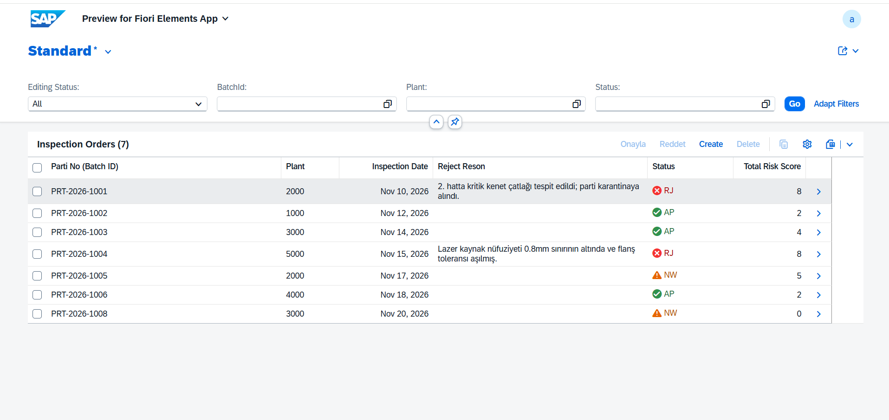
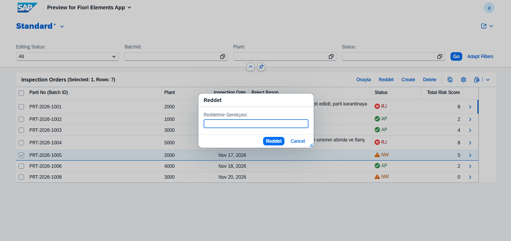
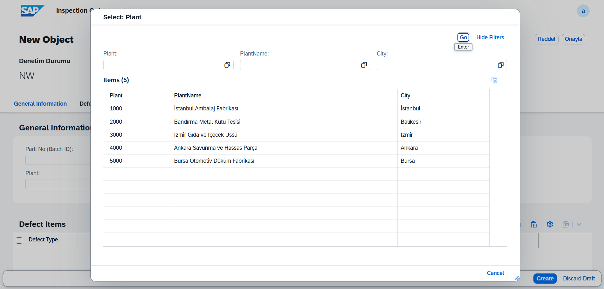
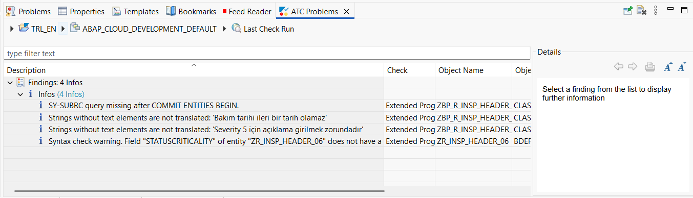

# Quality Inspection Management System (SAP BTP ABAP Cloud & RAP)

---

## 🇬🇧 English Overview

An end-to-end **Quality Inspection & Defect Management** application built on **SAP BTP ABAP Environment (ABAP Cloud)** using the **ABAP RESTful Application Programming Model (Managed RAP)** and **SAP Fiori Elements (OData V4)**.

### Key Technical Implementation
* **Composite Data Model & Draft Handling:** Parent-child `composition [0..*]` hierarchy between `ZR_INSP_HEADER_06` and `ZR_INSP_ITEMS_06` built under `strict ( 2 )` BDEF guidelines with stateful **Draft** persistence (`zinsp_header_d`, `zinsp_items_06_d`) and optimistic concurrency control via `Total ETag` / `Local ETag`.
* **EML Business Logic & Side Effects:**
  * **Determinations (`IN LOCAL MODE`):** Automatically initializes default status (`NW`) on creation (`setDefaultValues`) and dynamically aggregates defect severities into `TotalRiskScore` (`calculateTotalRisk`) with real-time UI updates configured via BDEF **Side Effects**.
  * **Validations (`on save` / `Prepare`):** Enforces business integrity by preventing future inspection dates and mandating detailed comments for critical defects (`Severity = 5`) via `%tky`, `failed`, and `reported` structures.
* **Parameterized Actions & Dynamic Feature Control:**
  * Custom `ApproveBatch` and `RejectBatch` actions; `RejectBatch` leverages a transient **Abstract Entity** (`ZA_REJECT_REASON_06`) to render a Fiori popup dialog and capture `%param` rejection reasons.
  * Instance-level UI locking (`get_instance_features`) dynamically disables edit, delete, and action buttons (`fc-o-disabled`) once an order reaches a final state (`AP` or `RJ`).
* **Instance-Level Security:** Protects update, delete, and status transitions inside `get_instance_authorizations` using a custom Authorization Object (`ZAO_INSP06`) validating `Plant` (`ZAF_PLANT`) and `ACTVT` permissions.
* **Value Helps & Clean Core Quality:** Master data F4 helps (`@Consumption.valueHelpDefinition` with `useForValidation: true`), **0 Errors** under ATC `ABAP_CLOUD_DEVELOPMENT_DEFAULT` checks, and isolated **ABAP Unit** tests utilizing `cl_cds_test_environment`.

---

## 🇹🇷 Türkçe Açıklama

**SAP BTP ABAP Environment (ABAP Cloud)** üzerinde **Managed RAP** mimarisi ve **SAP Fiori Elements (OData V4)** kullanılarak uçtan uca geliştirilmiş **Kalite Kontrol ve Kusur Yönetimi** uygulaması.

### Öne Çıkan Teknik Detaylar
* **Composite Veri Modeli ve Draft Yönetimi:** `ZR_INSP_HEADER_06` ve `ZR_INSP_ITEMS_06` varlıkları arasında `composition [0..*]` ilişkisi kurulmuş; `strict ( 2 )` BDEF standartlarıyla **Draft** tabloları (`zinsp_header_d`, `zinsp_items_06_d`) ve `Total ETag` / `Local ETag` eşzamanlılık kontrolleri yapılandırılmıştır.
* **EML İş Mantığı ve Side Effects:**
  * **Determinations (`IN LOCAL MODE`):** Kayıt oluşumunda varsayılan durum (`NW`) ataması (`setDefaultValues`) ve alt kalemlerdeki kusur şiddetlerine (`Severity`) göre toplam risk skorunun (`TotalRiskScore`) anlık hesaplanması (`calculateTotalRisk`) ile BDEF **Side Effects** entegrasyonu sağlanmıştır.
  * **Validations (`on save` / `Prepare`):** İleri tarihli muayene girişini engelleyen ve kritik kusurlarda (`Severity = 5`) açıklama zorunluluğu getiren doğrulamalar `%tky`, `failed` ve `reported` yapılarıyla kodlanmıştır.
* **Parametreli Aksiyonlar ve Dinamik Özellik Kontrolü:**
  * `ApproveBatch` ve `RejectBatch` özel aksiyonları geliştirilmiş; reddetme işleminde **Abstract Entity** (`ZA_REJECT_REASON_06`) kullanılarak Fiori popup penceresi üzerinden `%param` ile reddetme gerekçesi alınmıştır.
  * `get_instance_features` metoduyla onaylanan (`AP`) veya reddedilen (`RJ`) belgelerin düzenleme, silme ve aksiyon butonları (`fc-o-disabled`) dinamik olarak kilitlenmiştir.
* **Instance Bazlı Yetkilendirme:** Özel yetkilendirme nesnesi (`ZAO_INSP06`) üzerinden `get_instance_authorizations` içinde `AUTHORITY-CHECK` çalıştırılarak üretim yeri (`ZAF_PLANT`) ve aktivite (`ACTVT`) bazlı güvenlik sağlanmıştır.
* **Value Help (F4) & Clean Core Güvencesi:** Master Data tablolarına bağlı `@Consumption.valueHelpDefinition` (`useForValidation: true`) tanımları, ATC `ABAP_CLOUD_DEVELOPMENT_DEFAULT` kontrolünde **0 Error** sonucu ve `cl_cds_test_environment` ile izole **ABAP Unit** testleri uygulanmıştır.

---

## Application Preview / Ekran Görüntüleri

| List Report (Criticality & Filters) | Object Page (Detail & Locked Features) |
| :---: | :---: |
|  |  |

| Parameterized Reject Action (Popup) | Business Rule Validation & Value Help |
| :---: | :---: |
|  |  |

| ATC Clean Core Report (`0 Errors`) |
| :---: |
|  |

---

**İbrahim Gündoğmuş** — Computer Engineering | SAP ABAP & BTP Cloud Developer
