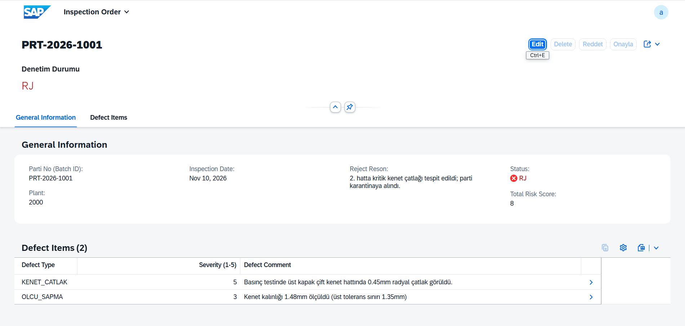

# Quality Inspection Management System (SAP BTP ABAP Cloud & RAP)

**SAP BTP ABAP Environment (ABAP Cloud)** üzerinde **Managed RAP** mimarisi ve **Fiori Elements (OData V4)** kullanılarak geliştirilmiş uçtan uca Kalite Kontrol Yönetim uygulaması.

## Temel Özellikler

* **Composite Veri Modeli:** Üst başlık (`ZR_INSP_HEADER_06`) ve alt kusur kalemlerinden (`ZR_INSP_ITEMS_06`) oluşan **Draft** destekli yapı.
* **Otomatik Risk Skorlaması:** Alt kalemlerdeki kusur şiddetine (`Severity`) göre üst başlıktaki risk skorunu dinamik olarak hesaplayan `Determination`.
* **Parametreli Aksiyon (Popup):** `RejectBatch` aksiyonu ile **Abstract Entity** üzerinden zorunlu reddetme gerekçesi alan diyalog penceresi.
* **Dinamik UI & Yetki Kontrolü:** Kayıt statüsüne göre butonları kilitleyen `get_instance_features` ve özel yetkilendirme nesnesi (`ZAO_INSP06`) ile fabrika bazlı kontrol sağlayan `get_instance_authorizations`.
* **Veri Doğrulama & F4:** `Validations` kuralları ve Master Data tablolarına bağlı `@Consumption.valueHelpDefinition` tanımları.
* **Kalite ve Test Güvencesi:** `ABAP_CLOUD_DEVELOPMENT_DEFAULT` varyantında **0 Error** ATC Clean Core uyumluluğu ve `cl_cds_test_environment` ile izole **ABAP Unit** testleri.

## Ekran Görüntüleri

| List Report | Object Page (Detay & Kilitli Butonlar) |
| :---: | :---: |
|  | 
) |

| Parametreli Reddetme Popup'ı | İş Kuralı Doğrulama (Value Help) |
| :---: | :---: |
|  | ) |

ATC Clean Core Raporu |
| :---: |
|  |

**İbrahim Gündoğmuş** — Computer Engineering | SAP ABAP & BTP Cloud Developer
